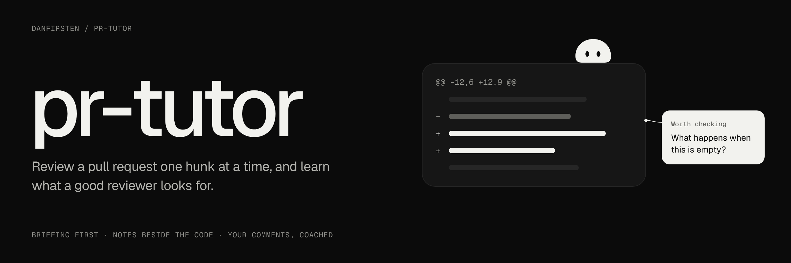

# pr-tutor

Review GitHub pull requests one hunk at a time, with Claude's notes beside the code, and learn what a good reviewer looks for while you do it.

You open a PR and get a briefing first: what it's for, where the real change lives, the order to read the files in, and what's safe to skim. Then you walk the diff hunk by hunk. Beside each hunk Claude explains what it does, what a careful reviewer would check, any real concerns, and the concept behind the code when there's something worth learning. You write your own comments, and Claude can coach them to be clearer and kinder. When you're done, Claude Code looks over your review and posts it.

Everything runs on your machine. PRs are read with the `gh` CLI, and Claude is reached through the Claude Code CLI on your own Claude subscription. There's no API key and no separate bill.

## What you need

- Node 23.6 or newer
- [GitHub CLI](https://cli.github.com), signed in with `gh auth login`
- [Claude Code](https://claude.com/claude-code), signed in. Run `claude` once and use `/login` if you haven't.

## Install

```bash
git clone https://github.com/danfirsten/pr-tutor.git
cd pr-tutor
npm install
npm install -g .
pr-tutor install-skill
```

`npm install` builds the page, and `npm install -g .` puts `pr-tutor` on your PATH. The last command copies the `pr-tutor-review` skill into `~/.claude/skills/`, so Claude Code can look over and post your reviews.

To update later, run `git pull && npm install && npm install -g .` in the same folder.

## Use it

```bash
pr-tutor https://github.com/owner/repo/pull/123
```

The page opens in your browser at `localhost:4517`. Running it again for another PR reuses the same server.

Everything works from the keyboard. The main keys:

| Key | Does |
|---|---|
| `⌘K` | Jump to any file, hunk, concern or comment |
| `j` / `k` | Next / previous hunk |
| `g` then `1`–`9` | Go to that hunk in the file |
| `n` / `p` | Next / previous file |
| `.` / `,` | Next / previous concern from Claude, across files |
| `⌘[` / `⌘]` | Back / forward to where you jumped from |
| `↓` / `↑` | Move the line cursor (hold `⇧` to cover several lines) |
| `c` or `Enter` | Comment on the cursor line or lines |
| `e` | Edit your comment on this line |
| `a` | Use Claude's concern on this line as a comment |
| `q` / `Q` | Ask Claude about the cursor line(s) / about its concern on this line |
| `]` / `[` | Jump to your next / previous comment |
| `f` | Whole file with the changes inline, keeping your line |
| `/` / `\` | Filter the file list / hide it |
| `x` | Mark the file reviewed |
| `b` / `r` / `m` | Briefing / your review / what you tend to miss |
| `t` | Take first on / off |
| `?` | Every key, including the ones inside a comment (`⌘↵` save, `Esc` or `⌘.` cancel, `⌥1`–`⌥4` label, `⌥C` coach) |

Click any line to put the cursor there, in a hunk or the whole file, then carry on with `↓` / `↑`. `⇧`-click stretches it, and the `+` in the gutter comments on a line straight away. The strip above the diff shows every hunk in the file, the rail beside it the whole PR, and both mark where Claude found a blocker or should-fix and where you've commented. The address keeps your file, hunk and line, so a reload lands where you were. Pick a label: **blocker** must change before merging, **suggestion** is the author's call, **question** asks to understand, and **nit** is tiny and optional. Press **Coach this** to have Claude check your comment is right and help you word it.

Not sure what a line does, or whether one of Claude's concerns is right? Press `q` to ask about the cursor line or lines (or the whole hunk with no cursor), or **Ask** on a concern. The answer shows in the notes pane, you can follow up, and every question is saved with the PR in `asks.json`, so it's still there next time.

Open **Your review** in the sidebar to write a summary and pick a verdict. Everything saves as you type to:

```
~/.pr-tutor/reviews/<owner>/<repo>/<number>/review.md
```

Then, in Claude Code:

> look over my review of owner/repo#123

Claude reads your draft, checks each comment against the code, tells you what's good and what to fix, shows exactly what it will post, and posts it as one GitHub review once you say yes.

Reviewing your own PR before anyone else sees it? Say "apply my pr-tutor review" instead. Claude treats your comments as a to-do list, fixes the code once you agree the plan, and never posts anything.

## Review your own branch before you push

Run this inside a repo, on the branch you want to check:

```bash
pr-tutor --local
pr-tutor --local --base origin/dev
```

It reviews `git diff <base>...<branch>`, so only committed work is included, and you get the same briefing, notes and line comments as for a PR. The title comes from your latest commit, and the commit messages stand in for the PR description. Without `--base` it uses `origin/HEAD`, then `main` or `master`. It doesn't need `gh` or a remote.

Nothing gets posted from a local review. There's no verdict, and the comments become a checklist saved to:

```
~/.pr-tutor/reviews/<owner>/<repo>/local/<branch>/review.md
```

Owner and repo come from a GitHub `origin` remote, or `local/<folder name>` without one. Fix what you found, commit, and run `pr-tutor --local` again. Notes are cached per commit, so the new head gets fresh ones, and comments from the earlier commit are flagged as written on an older version.

## What gets sent where

- To git, for `--local`: read-only commands in your repo (`diff`, `log`, `show`). Nothing is written to it.
- To GitHub, through `gh`: read requests for the PR, its files and file contents. Nothing is written to GitHub until you approve a post in Claude Code.
- To Claude, through your Claude Code login: the PR title and description, the diff, and the changed files' contents, so the notes have context. Calls run with tools switched off and without your Claude Code settings, hooks or MCP servers.
- On disk, in `~/.pr-tutor/`: the PR snapshot, cached notes (keyed by commit, so they regenerate when the PR changes) and your drafts.

Notes use Sonnet by default to go easy on your usage limits. To change that, put `{ "model": "opus" }` in `~/.pr-tutor/settings.json`. A PR over 60 files or 3,000 changed lines only gets notes for the files you open.

## When something goes wrong

- **"Claude Code isn't signed in"**: run `claude` in a terminal, use `/login`, then press Retry on the page.
- **"gh isn't ready"**: run `gh auth login`. For a private repo, your `gh` login needs access to it.
- **Port in use**: set `PR_TUTOR_PORT=4600` before running.

## Develop

```bash
npm install
npm test
npm run check
npm run build && node server/cli.ts owner/repo#123
```

`docs/SPEC.md` describes what it does, and `docs/PLAN.md` how it was built.
